# Commit City

**This is my portfolio, as a comic book you can drive through.** I'm Kommana Sriram, a student developer who likes
building things people can actually play with, so instead of a page of cards I built a city.

Scroll down and my character jumps off the tallest tower, fires a commit line and swings down through a living 3D city,
drawn in ink and print dots like a comic page. Every building in the skyline is one of my GitHub repos and every lit
window is a real commit. Press **Hop in** and you take an auto-rickshaw through the streets to five things I've built,
where each project turns into its own small arcade game. At the bottom, you can leave me a note on a public wall that
runs on AWS.

In a hurry? About Me, Skills and Projects are all on the first page as plain, readable sections. No game required.

**▶ Live: https://main.d1h3ar9heyq57z.amplifyapp.com/**

Built for the **AWS Student Builder Challenge: Build Your Tech Superpower**, and hosted on AWS Amplify.

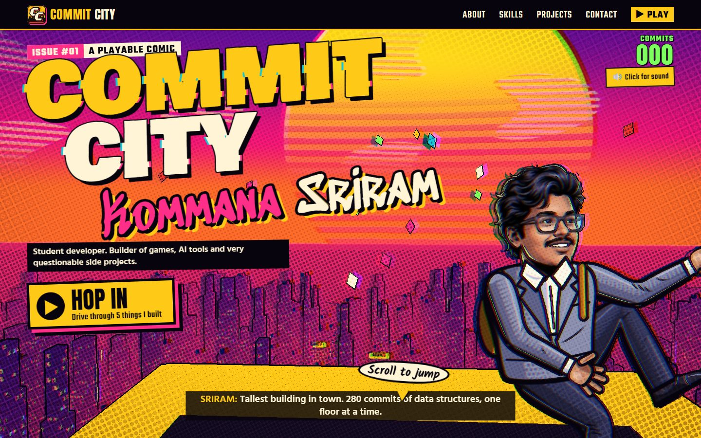

## The idea

Most student portfolios look the same: a photo, a list of skills with percentage bars, and a grid of project cards.
I wanted mine to show what I like building, which is things people can actually play with.

GTA 6 was coming out, and I like Spider-Man, so I mixed the two feelings: an open city you move through,
drawn like a comic book. That became **Commit City**. Scrolling the page makes my character jump off the tallest tower
and swing down through a 3D city into a street chase. Every building in the skyline is one of my 21 public GitHub repos,
and every lit window is one of their 554 commits. The tallest tower is real too: it's my data structures repo, with 280
commits.

The portfolio still works as a normal portfolio. About Me, Skills and Projects are plain HTML on the first page, so
someone in a hurry can read everything in 30 seconds without playing anything.

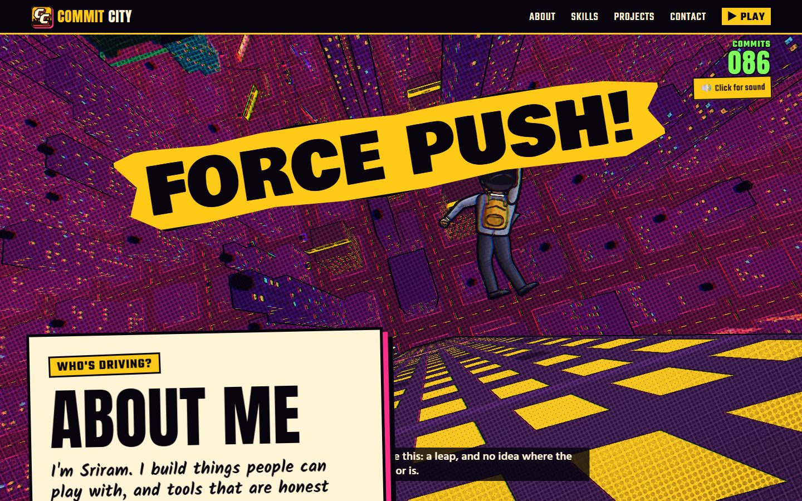

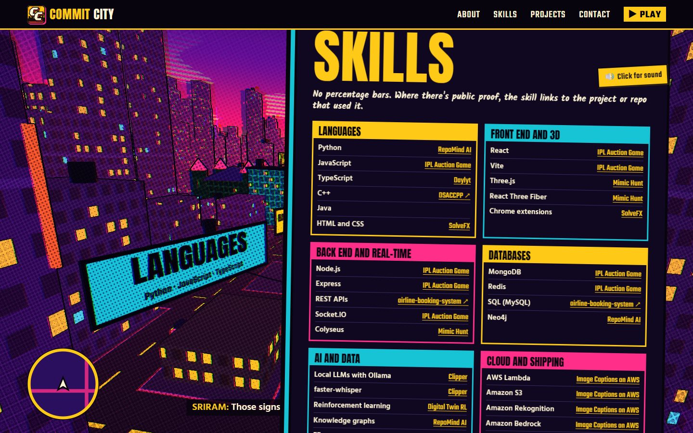

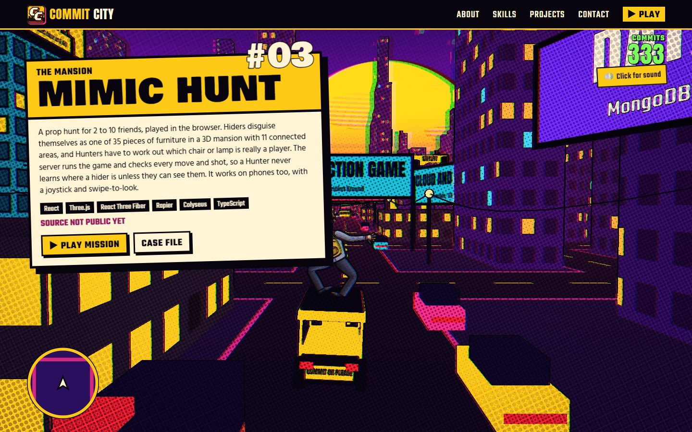

## The creative feature: Hop in

The **Hop in** button starts story mode. You drive an auto-rickshaw through the same 3D city, with arrow keys, WASD or
touch buttons, to five landmark buildings. Each stop is one of my real projects, and each one is a different small
arcade game built from what that project actually does:

| Stop | Project | The game |
|---|---|---|
| The Hostel | SolveFX | The lights go out at 2 AM and the LeetCode verdicts hunt you down. Each hit shows SolveFX's real overlay. |
| Cricket Ground | IPL Auction Game | You're the auctioneer, and the AI franchises (with my game's real bidding personalities) start bidding money they don't have. |
| Tech Street | RepoMind AI | A codebase is a building, and bugs keep drilling shortcuts through its layers. That's the architecture drift RepoMind finds. |
| Film Market | Clipper | You cut a trailer from Clipper's real scored moments while the audio, captions and GPU break, like they really did. |
| The Mansion | Mimic Hunt | Find me hiding as furniture, which moves when you're not looking. |

Each game ends in a BUILD PASSED or BUILD FAILED stamp and a case card about the project. After three stops a phone
rings, and the mystery caller turns out to be the visitor.

The hint is always visible but never blocks anything: a "Hop in: drive through 5 things I built" button, and a "Scroll
to jump" bubble on the first screen.

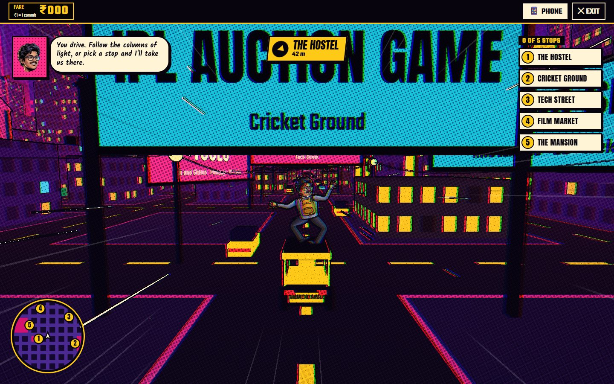

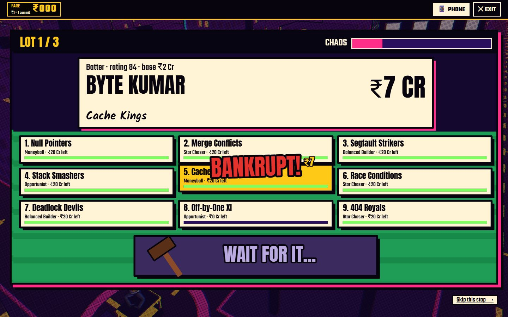

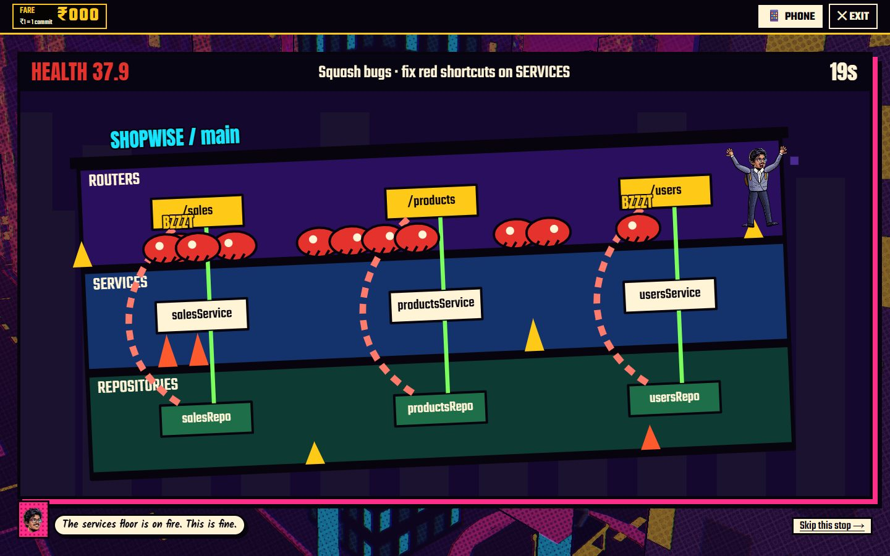

Every project also has its own page with what it does, why I built it, and links to the code.

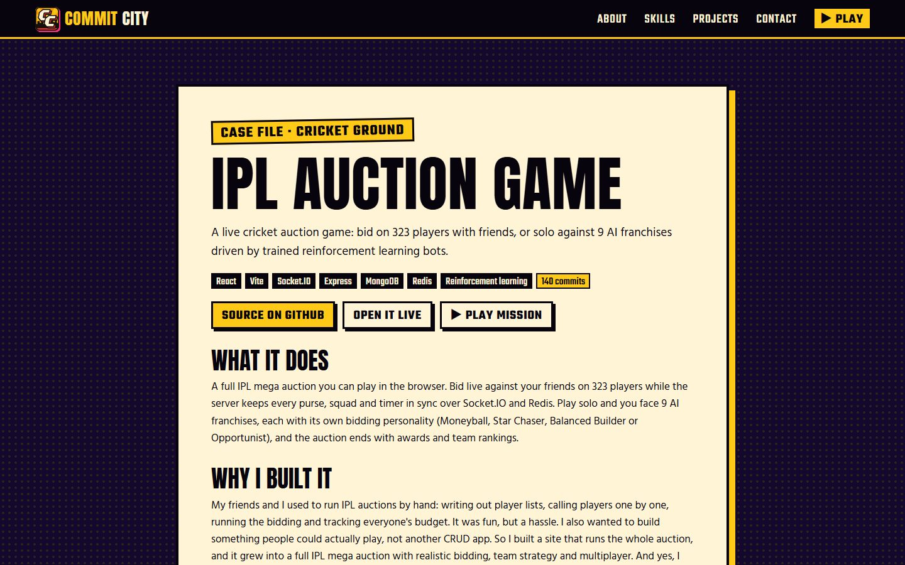

## How AWS runs it

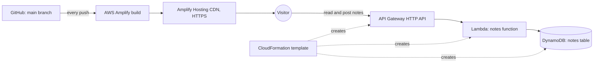

| Service | What it does here |
|---|---|
| **AWS Amplify Hosting** | Builds the site from GitHub on every push to `main`, using `amplify.yml`, and serves it over HTTPS from a global CDN. A build fails if any placeholder text is left in the content, and a failed build never takes the live site down. |
| **Amazon API Gateway** (HTTP API) | The public endpoint for the notes wall: `GET` lists notes, `POST` adds one. |
| **AWS Lambda** | The notes function (Node.js 22, 128 MB). It checks every note before saving it, because notes go live instantly. |
| **Amazon DynamoDB** | Stores the notes (on-demand billing). A second kind of item holds the 30-second rate limit, and DynamoDB's TTL deletes those automatically. |
| **AWS CloudFormation** | One template, [`aws/notes/template.yaml`](aws/notes/template.yaml), creates the API, the function, the table and the permissions in one step. |
| **AWS IAM** | The function's role can only query and add items in that one table, plus write its own logs. |
| **AWS Budgets** | A zero-spend budget emails me if anything ever costs money. |

Everything runs in **Asia Pacific (Mumbai)**, and visitors anywhere get the site from the CDN location nearest to them.

### The notes wall

At the bottom of the page, visitors can leave a note, feedback or a hello, and it goes up on the wall straight away.
Because there's no one approving notes, the Lambda function protects the wall:

- Notes are 2 to 240 characters, and names up to 32.
- Links are refused, which stops most spam.
- A short list of swear words is masked with asterisks.
- One note per visitor every 30 seconds. Visitors are told apart by a hash of their IP address, so the address itself is
  never stored.
- A hidden form field catches bots: they're told the post worked, and nothing is saved.
- The page shows notes as plain text, so nothing anyone writes can turn into code on the page.

The function is tested against an in-memory stand-in for DynamoDB (`npm run test:notes`), and `npm run build:notes`
rebuilds the template from the tested code.

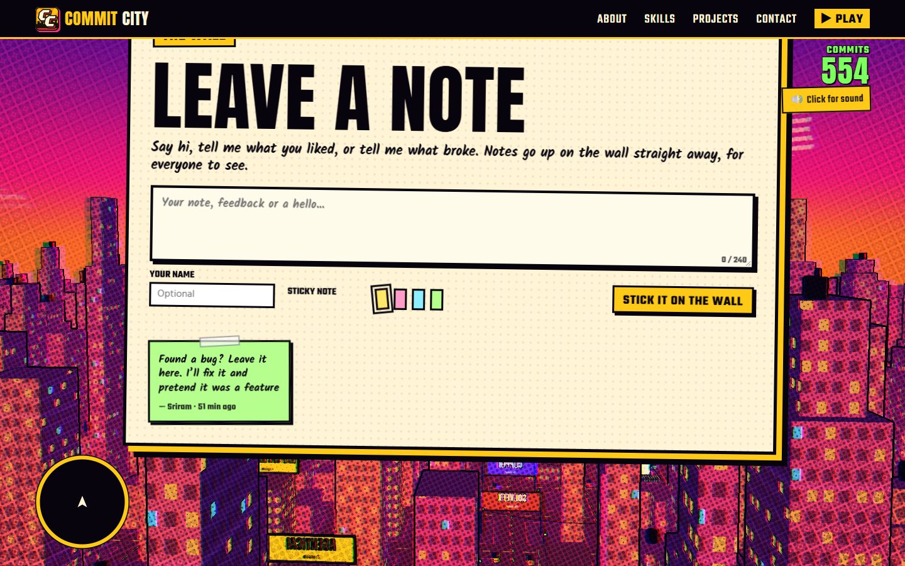

### The AWS setup

Amplify Hosting, with the `commit-city` app deployed from the `main` branch:

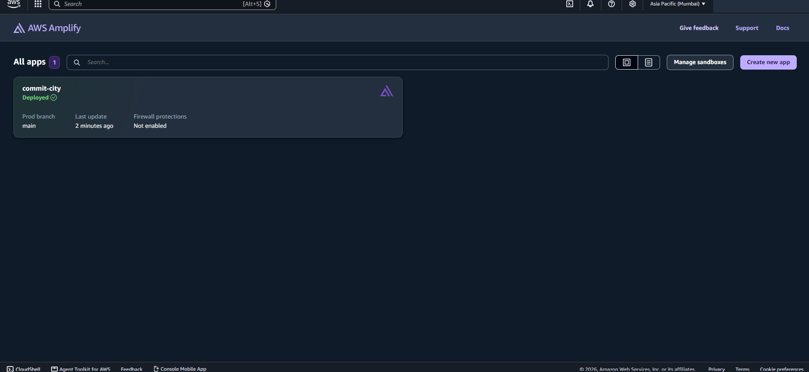

The CloudFormation stack that created the notes backend in Mumbai:

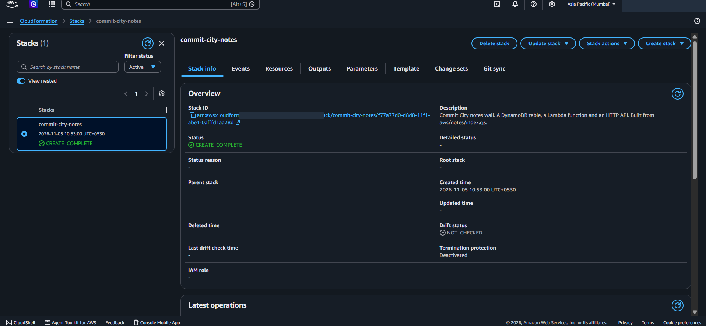

Its Resources tab: the five things that one template created.

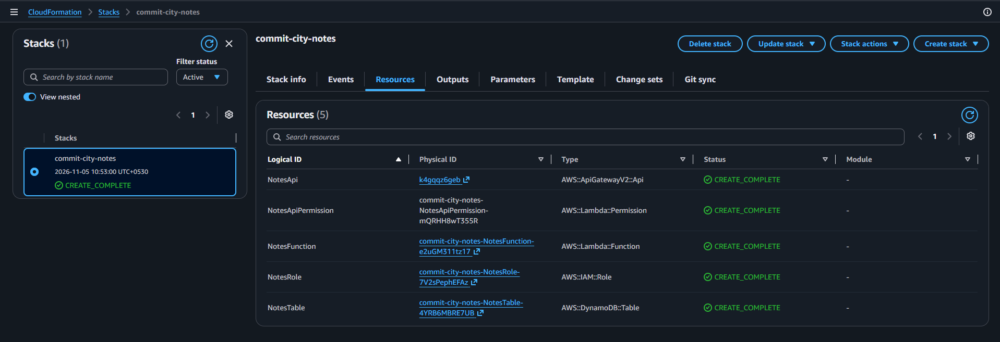

The Lambda function, with API Gateway as its trigger:

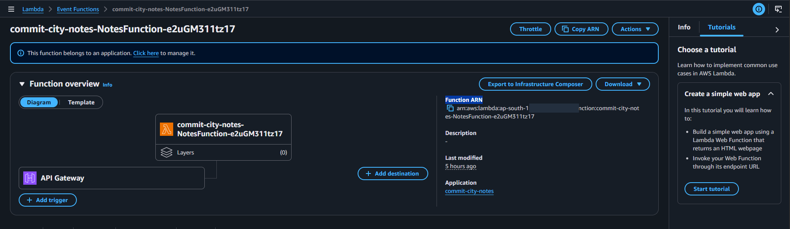

The DynamoDB table holding the first note on the wall:

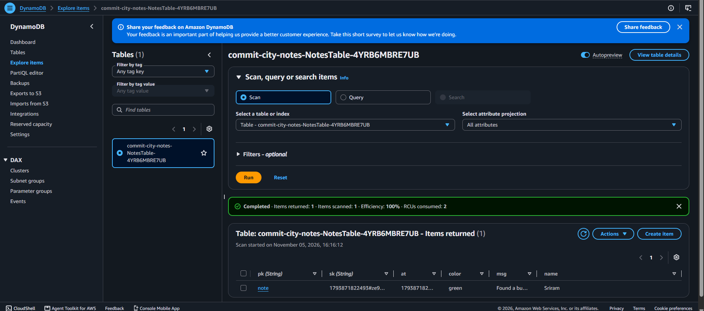

## How the site is built

| Part | Choice | Why |
|---|---|---|
| Pages | Astro, static output | Real HTML for every page, with almost no JavaScript on load |
| 3D city | Three.js with my own comic shader | Ink lines, print dots and off-register colour, so it looks like a comic page |
| Story mode | TypeScript, canvas and GSAP | Downloads only after you press Hop in |
| Art and sound | Drawn and synthesised in code | No audio files at all, and the only illustration is my face |
| GitHub data | Captured at build time | The live site calls no GitHub API, so it can't hit rate limits |

It also works without WebGL: the page and story mode fall back to a painted sky and a drawn map. On a laptop with
integrated graphics, the whole scroll journey ran at 69 fps at 1080p.


## Challenges

- **The first version looked like a static poster.** It had a big title and nothing else, so I rebuilt the landing page
  as a real-time 3D city. That one decision shaped everything after it.
- **Games that froze on slow devices.** My test browser sometimes ran zero animation frames per second, and story mode
  hung because it waited on animation callbacks. Now the game runs on timers, and animation is only decoration.
- **Making the character look like me.** The first drawing looked nothing like me. Proportions guessed by eye gave a
  giant tower of hair. I laid a grid over my photos and traced the hairline, jaw and glasses as numbers. Later I switched
  to a comic illustration of my face and redrew the body in the same style to match it.
- **The stops weren't fun at first.** Version one was a quiz at each stop. Version two was driving challenges, like
  driving through test-case gates. Neither said much about the projects, so I threw both away and built five different
  arcade games, each one based on what the real project does. That took the most work, and it was worth it.
- **The auto got stuck in walls.** A car could push the auto into a building, and every move after that counted as a
  crash, so it could never move again. Pushes now check for walls first, and the auto steps out if it ever ends up inside one.
- **Sound that didn't play.** Browsers block sound until the visitor clicks, and scrolling doesn't count. The button
  said "Sound on" while the page was silent, and the first press turned it off. Now it says "Click for sound" until
  sound can really play.
- **A bug that only showed up on AWS.** On deploy, notes failed to post from the browser. API Gateway was passing the
  browser's CORS preflight request to my function, which refused it. Testing locally with a fake API never sent that
  request. I found it by testing the real endpoint from the live site, and fixed it by sending notes in a format that
  doesn't need a preflight. I also changed the function's code to answer preflights, for any client that sends them.

## What I learned

- **Test against the real cloud, not only a fake.** My fake API passed every test, and the real one still failed in
  the browser. Five minutes of testing the live endpoint found it.
- **Infrastructure as code is worth it even for small things.** One CloudFormation template means I can delete and
  rebuild the whole backend in a minute, and anyone reading the repo can see exactly what runs on AWS.
- **Anything public needs protecting from day one.** An open wall with no moderation needs limits, a spam filter and
  plain-text rendering before the first visitor arrives, not after.
- **Cut what isn't fun.** I deleted two full versions of the stops. Each was "working", but working isn't the same as
  good.
- **A creative site still has to be a usable site.** Keeping About, Skills and Projects as plain HTML meant the creative
  part could be as wild as I wanted without hiding the information a recruiter needs.

## Run it locally

Needs Node 24.

```bash
npm install
npm run dev
```

| Path | What it holds |
|---|---|
| `content/*.json` | All the words and mission data, editable without touching code |
| `src/pages`, `src/components` | The portfolio and project pages |
| `src/world` | The 3D city, the character and the sound |
| `src/game` | Story mode and the five arcade games, loaded after Hop in |
| `aws/notes` | The notes wall: the Lambda code and the CloudFormation template |
| `DEV_LOG.md` | What broke and how it was fixed |
