<!--
FOR BUILDER CENTER (don't paste this comment)
Title:       Commit City: my portfolio, as a comic book you can drive through
Summary:     My portfolio is a 3D comic-book city. Scroll to swing through it, or hop in an auto-rickshaw and play a game at each of five things I built. Hosted on AWS Amplify, with a notes wall on Lambda and DynamoDB.
Cover image: docs/screenshots/01-hero.jpg
Paste everything below the line. If an image doesn't show, upload the file named at the end of its link.
-->

## Live site and code

- **Live portfolio:** https://main.d1h3ar9heyq57z.amplifyapp.com/
- **GitHub:** https://github.com/Sriram-Kommmana/commit-city

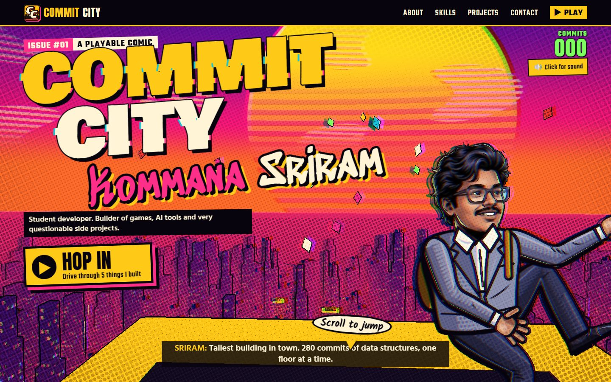

## About this project

I'm Kommana Sriram, a student developer, and I like building things people can actually play with. So instead of a
page of cards, my portfolio is a city.

GTA 6 was coming out, and I like Spider-Man, so I mixed the two: an open city you move through, drawn like a comic book
with ink lines and print dots. Scroll down and my character jumps off the tallest tower, fires a "commit line" and swings
down into a street chase. The skyline is real: every building is one of my 21 public GitHub repos, and every lit window
is one of their 554 commits. The tallest tower is my data structures repo, with 280 commits.

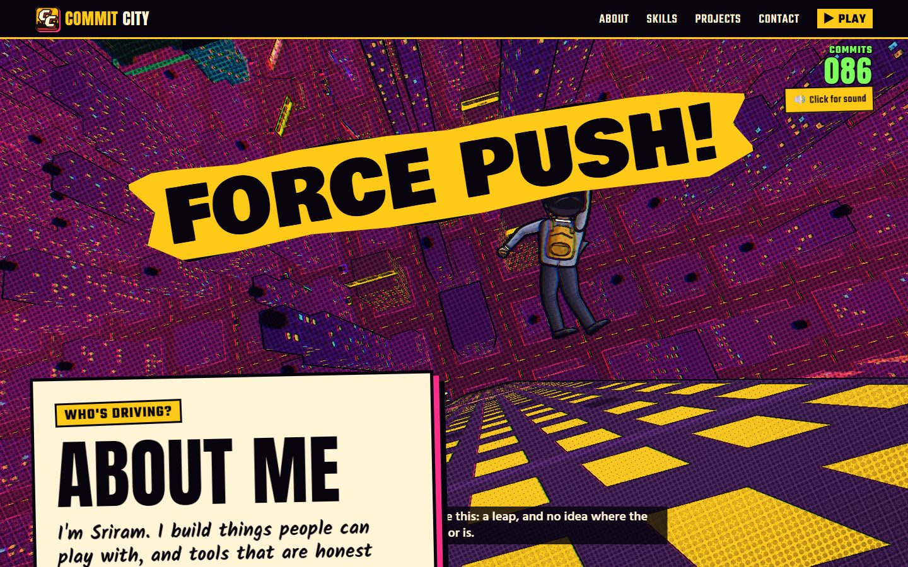

## The creative feature: Hop in

**How to find it:** the first screen has a big **Hop in** button ("Drive through 5 things I built") and a "Scroll to
jump" bubble. Neither one blocks the navigation bar or the rest of the page.

Hop in starts story mode. You drive an auto-rickshaw through the same 3D city, with arrow keys, WASD or touch buttons, to
five landmark buildings. Each stop is one of my real projects, turned into a small arcade game about what that project
actually does:

| Stop | Project | The game |
|---|---|---|
| The Hostel | SolveFX | The lights go out at 2 AM and LeetCode verdicts hunt you down. Each hit shows SolveFX's real overlay. |
| Cricket Ground | IPL Auction Game | You're the auctioneer, and AI franchises with my game's real bidding personalities bid money they don't have. |
| Tech Street | RepoMind AI | A codebase is a building, and bugs drill shortcuts through its layers: the architecture drift RepoMind finds. |
| Film Market | Clipper | Cut a trailer from Clipper's real scored moments while the audio, captions and GPU break, like they really did. |
| The Mansion | Mimic Hunt | Find me hiding as furniture that moves when you're not looking. |

Each game ends in a BUILD PASSED or BUILD FAILED stamp and a case card about the project. After three stops a phone
rings, and the mystery caller turns out to be the visitor.

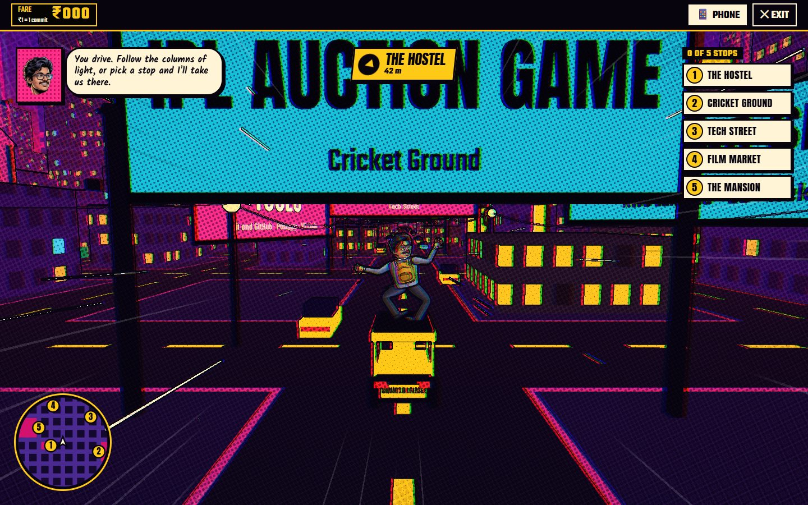

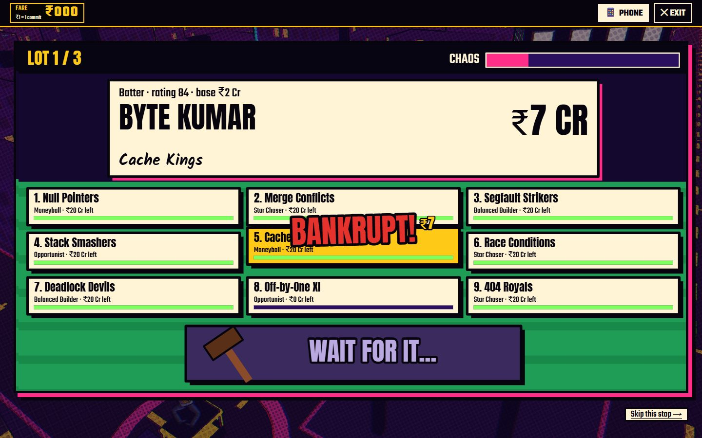

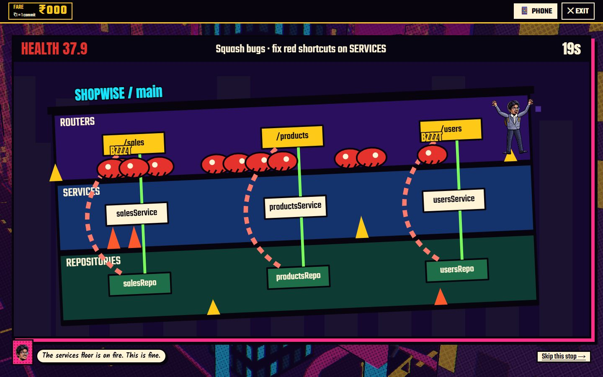

## Portfolio sections

The creative part never hides the information. **About Me**, **Skills** and **Projects** are plain, readable sections
on the first page, reachable from the navigation bar, so someone in a hurry can read everything in 30 seconds without
playing anything. Every skill links to the project that used it, and every project has its own page with what it does,
why I built it, and its code. It all works on phones too.

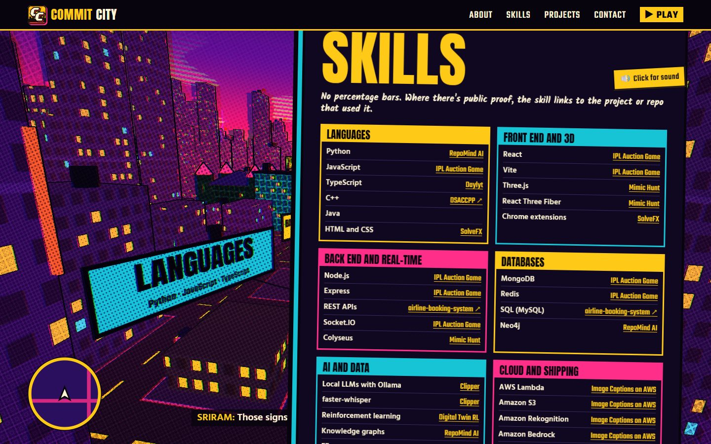

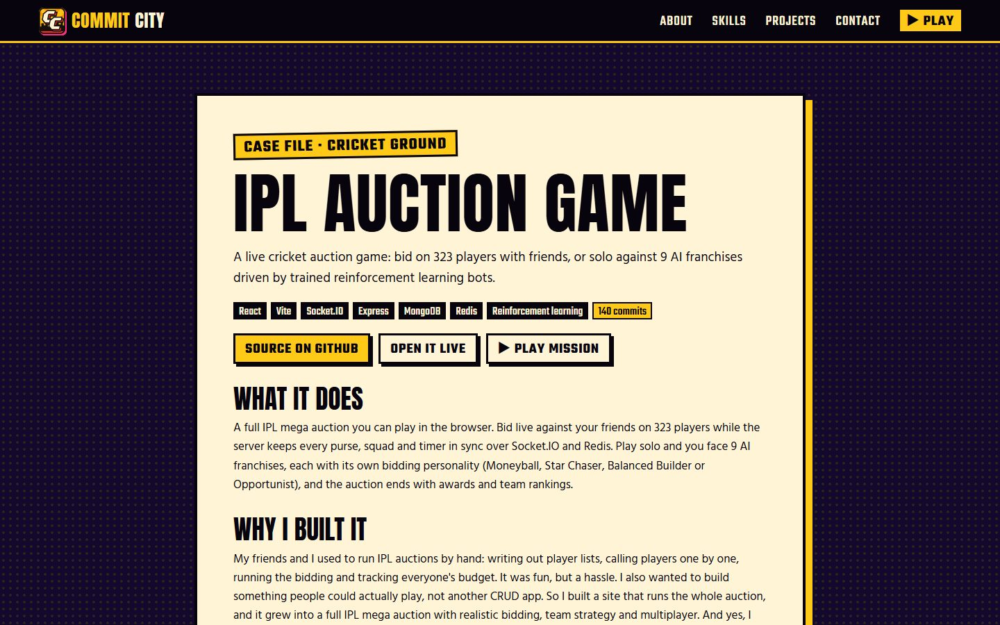

## AWS services used

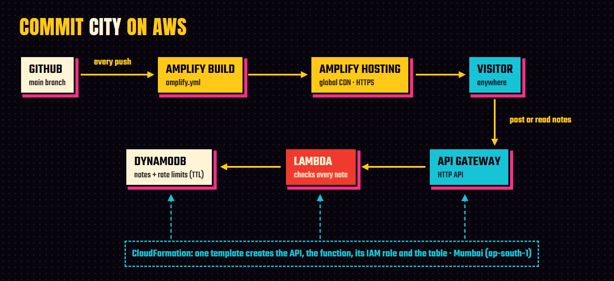

| Service | What it does |
|---|---|
| **AWS Amplify Hosting** | Builds the site from GitHub on every push to `main` and serves it over HTTPS from a global CDN. The build fails if any placeholder text is left, and a failed build never takes the live site down. |
| **Amazon API Gateway** (HTTP API) | The public endpoint for the notes wall: read notes, post a note. |
| **AWS Lambda** | Checks every note before saving it, because notes go live instantly. |
| **Amazon DynamoDB** | Stores the notes. A 30-second rate limit lives there too, and DynamoDB's TTL deletes those entries automatically. |
| **AWS CloudFormation** | One template creates the API, the function, its permissions and the table in one step. |
| **AWS IAM** | The function can only read and add items in that one table, plus write its own logs. |
| **AWS Budgets** | A zero-spend budget emails me if anything ever costs money. |

**The notes wall.** At the bottom of the page, visitors can leave a note and it goes up straight away. With no one
approving notes, the Lambda function protects the wall:

- notes are 2 to 240 characters;
- links are refused;
- swear words are masked;
- one note per visitor every 30 seconds, tracked by a hash of their IP so the address is never stored;
- a hidden field catches bots;
- the page shows notes as plain text, so nobody can inject code.

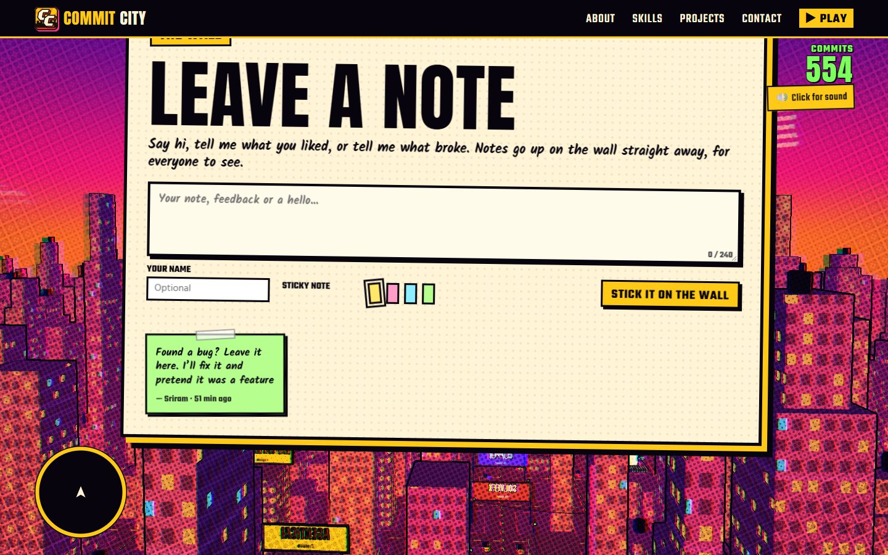

**The AWS setup:**

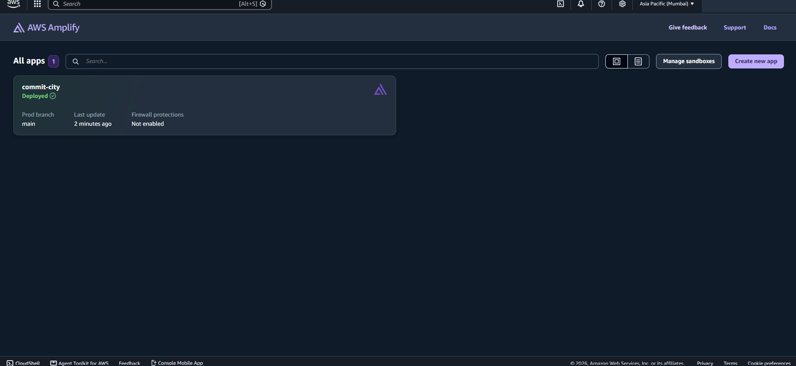

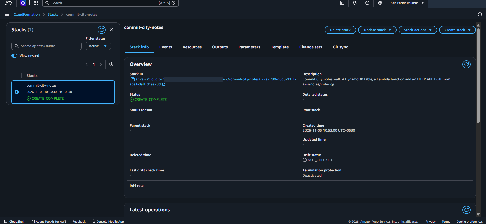

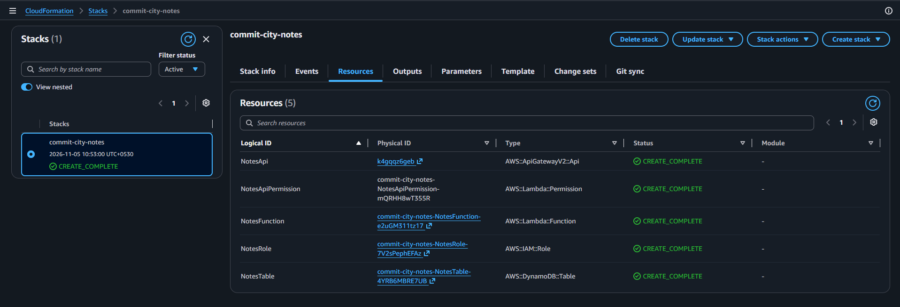

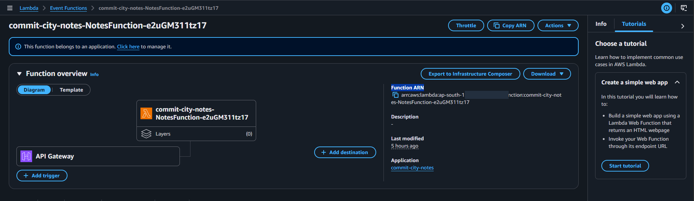

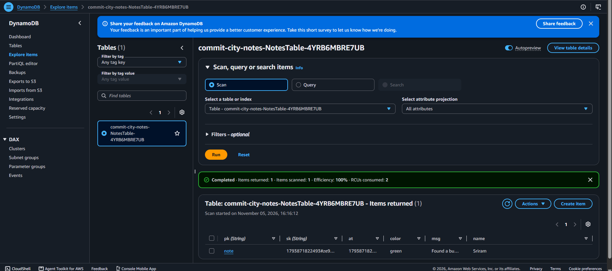

## How I built it

- **Astro** (static) for the pages, so every page is real HTML with almost no JavaScript on load.
- **Three.js** with my own comic shader for the city.
- **TypeScript, canvas and GSAP** for story mode, which only downloads after you press Hop in.
- **Art drawn and sound synthesised in code.** There are no audio files, and the only illustration is my face.
- **GitHub data captured at build time,** so the live site never calls the GitHub API.

Without WebGL, the page and story mode fall back to a painted sky and a drawn map. On a laptop with integrated graphics,
the whole scroll ran at 69 fps at 1080p.

## Challenges

- **The first version looked like a static poster,** so I rebuilt the landing page as a real-time 3D city.
- **The stops weren't fun.** Version one was a quiz, and version two was driving challenges. Neither said much about the
  projects, so I threw both away and built five different games, each based on what the real project does.
- **Story mode froze on slow devices,** because it waited on animation frames that a throttled browser never ran. Now
  the game runs on timers, and animation is only decoration.
- **Making the character look like me.** My first drawing looked nothing like me. I traced my photos on a grid, then
  switched to a comic illustration of my face and redrew the body to match it.
- **A bug that only appeared on AWS.** Notes failed to post from the browser. API Gateway was passing the browser's
  CORS preflight to my function, which refused it, and my local fake API never sent one. I found it by testing the real
  endpoint from the live site, and fixed it by posting notes in a format that needs no preflight.

## What I learned

- **Test against the real cloud, not only a fake.** My fake API passed every test, and the real one still failed.
- **Infrastructure as code pays off even for small things.** One CloudFormation template means I can rebuild the whole
  backend in a minute, and anyone can see exactly what runs on AWS.
- **Anything public needs protecting from day one:** limits, a spam filter and plain-text rendering, before the first
  visitor arrives.
- **Cut what isn't fun.** I deleted two working versions of the stops, because working isn't the same as good.
- **A creative site still has to be a usable one.** Keeping About, Skills and Projects as plain HTML let the creative
  part be as wild as I wanted.
